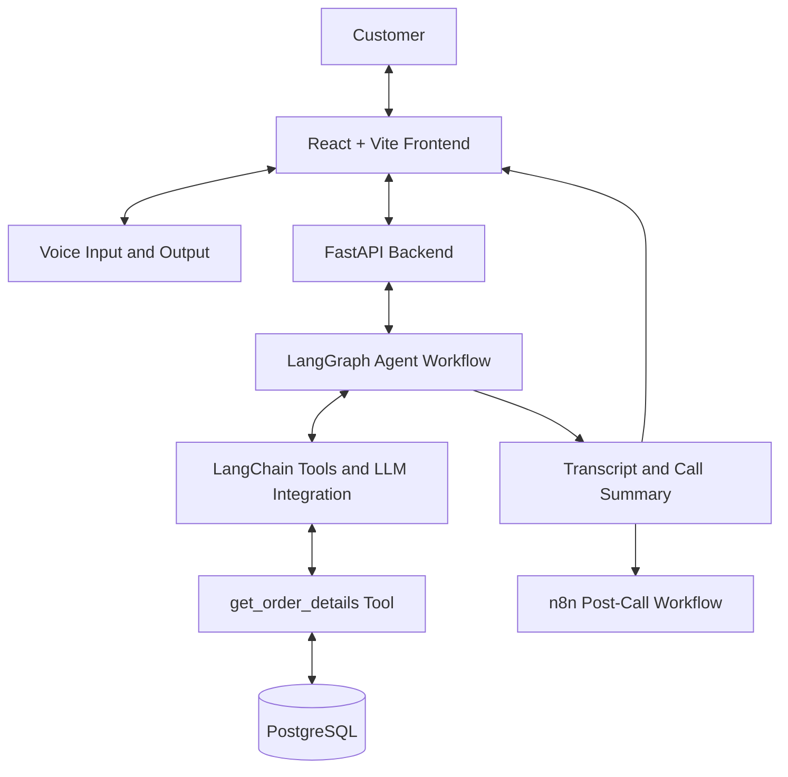

# Aura Skincare Voice Agent — System Architecture

## 1. Document Information

| Field | Value |
|---|---|
| Project | Aura Skincare Voice Agent |
| Document | System Architecture |
| Version | 1.0 |
| Status | Planned architecture; update as implementation is verified |

## 2. Architecture Overview

Aria uses a modular architecture with a React frontend, FastAPI backend, PostgreSQL database, AI agent workflow, browser-compatible voice integration, and an n8n post-call automation.

The frontend handles customer interaction. The backend coordinates application logic and data access. The AI workflow interprets requests, decides when to use tools, and generates responses grounded in available information.

The exact voice and LLM providers will be documented when selected.

## 3. High-Level Architecture



This diagram represents the intended architecture. The exact voice transport, tool execution path, and n8n trigger mechanism may change during implementation.

## 4. Component Responsibilities

### 4.1 React + Vite frontend

**Responsibilities**
- Display the customer-support interface.
- Request microphone access when required.
- Provide Start Call and End Call controls.
- Display Listening, Thinking, and Speaking states.
- Present customer and agent messages.
- Provide a visible test order helper.
- Display the transcript and JSON summary after the call.
- Communicate with the backend through the chosen API or voice integration.

**Does not own**
- Secret API keys.
- Direct database credentials.
- Authoritative business rules.
- Database queries.

### 4.2 Voice integration

The voice layer enables spoken customer input and spoken agent responses.

The selected implementation may use a real-time speech API or a modular speech-to-text, language-model, and text-to-speech pipeline.

**Responsibilities**
- Capture customer speech.
- Provide speech or transcript data to the conversation workflow.
- Deliver agent responses as audio.
- Communicate errors and interaction state to the frontend.

The selected provider and its limitations must be documented after implementation.

### 4.3 FastAPI backend

**Responsibilities**
- Expose HTTP endpoints for health checks and order lookup.
- Coordinate the AI agent workflow.
- Validate incoming requests.
- Manage database sessions.
- Handle application errors.
- Provide an integration point for post-call processing.

The backend must never trust model-generated order information when verified information can be obtained from the database.

### 4.4 PostgreSQL

PostgreSQL stores the assignment's mock order records.

The current `orders` table contains fields for:
- Internal database ID.
- Customer-facing order ID.
- Customer name.
- Product name.
- Order amount.
- Order status.
- Courier.
- Tracking number.
- Expected delivery information.
- Order timestamp, where available.
- Days since delivery, where applicable.
- Item summary.

The database is the source of truth for the supplied mock order data.

### 4.5 SQLAlchemy

SQLAlchemy provides the Python database-access layer.

It is responsible for:
- Mapping Python objects to database records.
- Creating and querying the `orders` table.
- Managing database sessions.
- Keeping database access separate from API and AI logic.

### 4.6 LangChain

LangChain will connect the selected language model to structured tools.

The order lookup function will be exposed to the model through an appropriate LangChain tool wrapper.

The tool should have a clear description so the model knows when to use it. The tool must retrieve real database results rather than allowing the model to invent order details.

### 4.7 LangGraph

LangGraph will coordinate the agent's stateful workflow.

The planned workflow will:
1. Receive the customer's request.
2. Maintain relevant conversation state.
3. Determine whether a tool is needed.
4. Execute an authorized tool call when appropriate.
5. return tool results to the model.
6. Generate a response grounded in the available information.
7. Continue the conversation or finish the call.

Additional nodes and checks may be added for errors, policy handling, and call completion.

The final graph should be documented after the actual workflow is implemented.

### 4.8 n8n

n8n will handle one post-call automation.

The planned workflow receives a completed call summary and processes or stores it in a chosen destination.

The implementation must define:
- How the workflow is triggered.
- The summary payload schema.
- Authentication.
- The destination for the summary.
- Error handling and retry behavior.
- How failed automation is reported.

The workflow must not claim successful delivery or storage unless the action has been confirmed.

## 5. Primary Data Flow: Order Status Question

Example: A customer asks, "Where is my order ORD-101?"

1. The customer speaks through the browser interface.
2. The voice integration supplies the request to the agent workflow.
3. LangGraph maintains the conversation state and determines whether order lookup is required.
4. The model invokes the `get_order_details` tool through the configured tool integration.
5. The tool queries PostgreSQL through SQLAlchemy.
6. PostgreSQL returns the matching order record.
7. The tool returns structured order details.
8. The agent generates a concise answer using the retrieved information.
9. The voice integration speaks the answer.
10. The frontend updates the conversation transcript.
11. At call completion, the system generates the required structured summary.
12. The summary is made available to the frontend and sent to the configured n8n workflow.

The tool must return a clear error for an unknown order ID. The agent should ask the customer to verify the ID rather than fabricate a result.

## 6. Business Policy Flow

Policy questions should be answered using the assignment's documented rules.

For order-specific questions, the agent should first retrieve verified order information where necessary.

Examples:
- A return question requires consideration of delivery date, product condition, and the seven-day window.
- A cancellation question requires consideration of the current order status.
- A shipping-fee question must respect the distinction between orders above and below ₹499 and avoid guessing about exactly ₹499.

The model must not treat an explanation of an action as proof that the action has been executed.

## 7. Database Design

The current schema uses a single `orders` table for the mock dataset.

### Current entity

**Order**
- `id`: internal primary key.
- `order_id`: unique customer-facing order ID.
- `customer_name`: customer name.
- `product_name`: product description.
- `amount`: order amount.
- `status`: current mock order status.
- `courier`: courier name, if available.
- `tracking_number`: tracking identifier, if available.
- `expected_delivery`: expected delivery description, if available.
- `ordered_at`: order timestamp, if available.
- `delivered_days_ago`: days since delivery, where supplied.
- `items_summary`: concise item description.

### Future database enhancements

If needed, separate tables may be introduced for:
- Calls.
- Transcript messages.
- Call summaries.
- Tool execution records.

These are not considered implemented until their schema and persistence behavior are added and tested.

## 8. API Design

### Current endpoints

| Method | Endpoint | Purpose |
|---|---|---|
| GET | `/` | API welcome response |
| GET | `/health` | Application and database health check |
| GET | `/api/orders/{order_id}` | Retrieve one order |

### Planned endpoints

Additional endpoints may be introduced for:
- Conversation processing.
- Call completion.
- Transcript and summary retrieval.
- Post-call automation.

Their exact request and response schemas will be recorded in `05_API_SPECIFICATION.md` after implementation.

## 9. Call Summary Contract

The required summary contains four fields:

```json
{
  "customer_intent": "Check order delivery status",
  "order_id": "ORD-101",
  "resolution_status": "resolved",
  "call_summary": "The customer asked about ORD-101. The agent provided the available delivery status and tracking information."
}
```

This is an illustrative example, not a record of an actual call.

The `resolution_status` value must reflect the actual outcome. The application should define a consistent set of allowed statuses before final implementation.

## 10. Security Architecture

- API keys remain on the server.
- Environment files are excluded from source control.
- PostgreSQL is bound to localhost during local development.
- Public deployment must use secure environment configuration.
- Database errors should not expose credentials or stack traces.
- Inputs must be validated before they reach database or tool logic.
- The agent must not have capabilities beyond the tools explicitly provided to it.
- Public deployment must restrict access to administrative resources as appropriate.

## 11. Error Handling

### Invalid or unknown order
Return a clear error without fabricating data.

### Database failure
Return a controlled error, log diagnostic details securely, and avoid exposing credentials.

### Model or tool failure
Inform the customer that the information could not be retrieved. Retry only when appropriate and safe.

### Voice failure
Show an understandable error and allow the user to end or retry the interaction.

### n8n failure
Record or report the automation failure without falsely claiming the summary was successfully processed.

## 12. Deployment Architecture

### Local development
- React + Vite runs in the development environment.
- FastAPI runs locally.
- PostgreSQL runs in Docker.
- `.env` contains local development configuration.
- The frontend communicates with the backend through configured local endpoints.

### Public deployment
- Frontend and backend are deployed to suitable hosting services.
- PostgreSQL is hosted securely.
- Required secrets are configured in the hosting environment.
- Browser-to-backend communication uses HTTPS.
- Voice provider configuration and allowed origins are set for the deployed application.
- n8n is configured to receive the intended post-call payload.

The actual hosting providers and deployment URLs will be recorded once selected.

## 13. Architecture Decisions

| Decision | Rationale |
|---|---|
| React + Vite | Separate, straightforward browser interface |
| FastAPI | Python API for database and AI integration |
| PostgreSQL | Persistent storage for mock order records |
| SQLAlchemy | Structured database access from Python |
| LangChain | Model and tool integration |
| LangGraph | Explicit, stateful conversational workflow |
| n8n | Demonstrate a post-call automation |
| Docker Compose | Reproducible local PostgreSQL environment |

These are project implementation choices, not necessarily mandatory technologies specified by the assignment.

## 14. Current Architecture Status

Verified:
- PostgreSQL is running locally in Docker.
- SQLAlchemy can connect to the database.
- The `orders` table exists.
- All three mock orders are present.
- The basic FastAPI order lookup works.

Planned or not yet verified:
- LangChain tool integration.
- LangGraph workflow.
- Browser voice integration.
- End-to-end call transcript and summary.
- n8n workflow.
- Public deployment.

## 15. Maintenance Rule

Whenever the implementation changes, update this document to match the actual system. Do not describe planned components as operational until they have been tested.