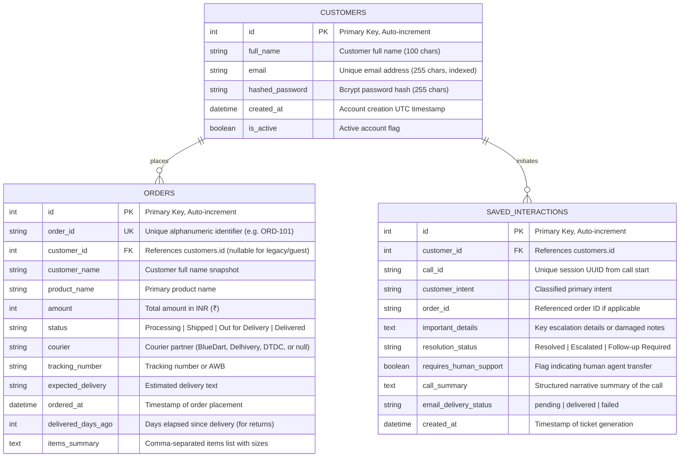

# Aura Skincare Voice Agent — Database Design

## 1. Document Information

| Field | Value |
|---|---|
| Project | Aura Skincare Voice Agent |
| Document | Database Design & Schema Specification |
| Version | 1.0 |
| Status | Implemented & Verified |
| DBMS | PostgreSQL 17 (Docker Compose: port 5433:5432) |
| ORM | SQLAlchemy 2.0 (Declarative Mapped Models) |

---

## 2. Overview & Design Principles

The Aura Skincare voice customer support system relies on PostgreSQL as the single source of truth for all transactional, customer, and call audit data. The database design adheres to these core architectural principles:

1. **Deterministic Data Grounding**: Order information returned by the voice assistant Aria is always read directly from PostgreSQL via structured SQLAlchemy queries. The LLM never hallucinates or guesses tracking, amounts, or order statuses.
2. **Strict Multi-Tenant Isolation**: Orders and interaction tickets are strictly associated with customer accounts via foreign keys. Every lookup tool verifies ownership (`customer_id`), preventing Insecure Direct Object Reference (IDOR) vulnerabilities.
3. **Auditability & Compliance**: Call summaries and customer intents are persisted in `saved_interactions` along with email delivery tracking for end-to-end auditability.
4. **Idempotent Automated Seeding**: The database auto-initializes on application startup, creating tables if missing and idempotently seeding realistic mock test data.

---

## 3. Entity-Relationship (ER) Diagram



---

## 4. Detailed Table Specifications

### 4.1 Table: `customers`

Stores registered customer profiles and authentication credentials.

| Column | Type | Nullable | Constraints | Description |
|---|---|---|---|---|
| `id` | `INTEGER` | No | `PRIMARY KEY`, Auto-increment | Internal unique identifier |
| `full_name` | `VARCHAR(100)` | No | — | Customer's full display name |
| `email` | `VARCHAR(255)` | No | `UNIQUE`, `INDEX` | Login email address |
| `hashed_password` | `VARCHAR(255)` | No | — | Bcrypt hashed password |
| `created_at` | `TIMESTAMP` | No | Default `CURRENT_TIMESTAMP` | Account creation UTC timestamp |
| `is_active` | `BOOLEAN` | No | Default `TRUE` | Soft-delete / active status flag |

**SQLAlchemy Model Definition (`backend/app/models.py`)**:
```python
class Customer(Base):
    __tablename__ = "customers"

    id: Mapped[int] = mapped_column(Integer, primary_key=True, index=True)
    full_name: Mapped[str] = mapped_column(String(100), nullable=False)
    email: Mapped[str] = mapped_column(String(255), unique=True, index=True, nullable=False)
    hashed_password: Mapped[str] = mapped_column(String(255), nullable=False)
    created_at: Mapped[datetime] = mapped_column(DateTime, default=lambda: datetime.now(timezone.utc), nullable=False)
    is_active: Mapped[bool] = mapped_column(Boolean, default=True, nullable=False)

    orders: Mapped[list["Order"]] = relationship("Order", back_populates="customer", cascade="all, delete-orphan")
    interactions: Mapped[list["SavedInteraction"]] = relationship("SavedInteraction", back_populates="customer", cascade="all, delete-orphan")
```

---

### 4.2 Table: `orders`

Stores customer orders, shipment states, carrier details, and return-window metrics.

| Column | Type | Nullable | Constraints | Description |
|---|---|---|---|---|
| `id` | `INTEGER` | No | `PRIMARY KEY`, Auto-increment | Internal unique record ID |
| `order_id` | `VARCHAR(30)` | No | `UNIQUE`, `INDEX` | Alphanumeric business identifier (e.g. `ORD-101`) |
| `customer_id` | `INTEGER` | Yes | `FOREIGN KEY (customers.id)`, `INDEX` | Owning customer account ID |
| `customer_name` | `VARCHAR(100)` | No | — | Name on the shipping label |
| `product_name` | `VARCHAR(255)` | No | — | Primary headline product name |
| `amount` | `INTEGER` | No | — | Total invoice value in INR (₹) |
| `status` | `VARCHAR(50)` | No | — | Current state: `Processing`, `In Transit`, `Out for Delivery`, `Delivered` |
| `courier` | `VARCHAR(100)` | Yes | — | Courier company name (`BlueDart`, `Delhivery`, `DTDC`) |
| `tracking_number` | `VARCHAR(100)` | Yes | — | Carrier tracking number / AWB |
| `expected_delivery` | `VARCHAR(100)` | Yes | — | Human-readable delivery estimate (e.g. `by 6 PM today`) |
| `ordered_at` | `TIMESTAMP` | Yes | — | Placement timestamp |
| `delivered_days_ago`| `INTEGER` | Yes | — | Number of days elapsed since delivery (used for 7-day return policy) |
| `items_summary` | `TEXT` | Yes | — | Complete list of SKUs and sizes included in the order |

---

### 4.3 Table: `saved_interactions`

Stores post-call support tickets, structured summaries, and n8n email automation delivery tracking.

| Column | Type | Nullable | Constraints | Description |
|---|---|---|---|---|
| `id` | `INTEGER` | No | `PRIMARY KEY`, Auto-increment | Unique support ticket ID |
| `customer_id` | `INTEGER` | No | `FOREIGN KEY (customers.id)`, `INDEX` | Authenticated customer ID |
| `call_id` | `VARCHAR(50)` | No | `INDEX` | Call session UUID |
| `customer_intent` | `VARCHAR(255)` | No | — | Classified inquiry type (e.g. `Order Cancellation Request`) |
| `order_id` | `VARCHAR(30)` | Yes | `INDEX` | Extracted or referenced order ID |
| `important_details`| `TEXT` | No | — | Crucial factual takeaways (damages, refusal notes) |
| `resolution_status`| `VARCHAR(50)` | No | — | Status tag (`Resolved`, `Escalated`, `Follow-up Required`) |
| `requires_human_support` | `BOOLEAN` | No | Default `FALSE` | Set to `TRUE` if customer needs human representative |
| `call_summary` | `TEXT` | No | — | Full paragraph summary of the voice call |
| `email_delivery_status` | `VARCHAR(50)` | No | Default `'pending'` | Updated by n8n webhook (`delivered` / `failed`) |
| `created_at` | `TIMESTAMP` | No | Default `CURRENT_TIMESTAMP` | Ticket creation timestamp |

---

## 5. Seed Dataset Specification

The application seeds 7 mock customers and 7 representative orders designed to exhaustively validate every branch of Aura Skincare's customer service policies:

### 5.1 Seed Customers

All seed accounts use the default test password: `Password123!`

| ID | Full Name | Email Address | Linked Orders | Primary Test Scenario |
|---|---|---|---|---|
| 1 | Priya Sharma | `priya@example.com` | `ORD-101` | Out for Delivery tracking & Cancellation refusal |
| 2 | Rahul Verma | `rahul@example.com` | `ORD-102` | Return window expired (Delivered 14 days ago) |
| 3 | Ananya Patel | `ananya@example.com` | `ORD-103` | Valid cancellation (Processing status) |
| 4 | Divesh Matkar | `matkardivesh26@gmail.com` | `ORD-104` | Out for Delivery with live email notification via n8n |
| 5 | Sneha Kapoor | `sneha@example.com` | `ORD-105` | In-Transit tracking inquiry |
| 6 | Rohan Mehta | `rohan@example.com` | `ORD-106` | Eligible return (Delivered 2 days ago, unopened) |
| 7 | Kavita Nair | `kavita@example.com` | `ORD-107` | Second Processing cancellation scenario |

### 5.2 Seed Orders & Policy Mapping

| Order ID | Customer | Product(s) | Amount | Status | Courier & AWB | Return Metric | Policy Test Case |
|---|---|---|---|---|---|---|---|
| **ORD-101** | Priya Sharma | Vitamin C Serum (30ml) | ₹699 | Out for Delivery | BlueDart / `BD-982103` | N/A | **Cannot cancel**; advise doorstep refusal |
| **ORD-102** | Rahul Verma | Hydrating Sunscreen SPF 50 | ₹499 | Delivered | Delhivery / `DL-441029` | 14 days ago | **Ineligible for return** (> 7-day limit) |
| **ORD-103** | Ananya Patel | Green Tea Face Wash + Toner | ₹850 | Processing | None (Pending) | N/A | **Eligible for cancellation** (status is Processing) |
| **ORD-104** | Divesh Matkar | Niacinamide 10% Glow Serum + B5 Moisturizer | ₹1,199 | Out for Delivery | BlueDart / `BD-771920` | N/A | High-value order; triggers live email workflow |
| **ORD-105** | Sneha Kapoor | Hyaluronic Acid Deep Moisture Gel | ₹649 | In Transit | Delhivery / `DL-883102` | N/A | Mid-shipment tracking; cannot cancel |
| **ORD-106** | Rohan Mehta | Salicylic Acid Pore Minimizing Cleanser | ₹499 | Delivered | DTDC / `DT-441209` | 2 days ago | **Eligible for return** (<= 7 days; asks condition) |
| **ORD-107** | Kavita Nair | Retinol 0.5% Night Repair Cream | ₹999 | Processing | None (Pending) | N/A | Valid cancellation before dispatch |

---

## 6. Access Control & Security

### 6.1 Ownership Validation
Direct SQL queries enforce customer ownership. The `get_order_details` function implements the following check:
```python
if customer_id is not None and order.customer_id is not None and order.customer_id != customer_id:
    return {
        "success": False,
        "error": f"Order {normalized_id} does not belong to your account."
    }
```
If Priya Sharma asks Aria about `ORD-102` (which belongs to Rahul Verma), Aria politely refuses:
> *"Aapka order ORD-102 aapke account se link nahi hai. Privacy reasons ki wajah se main ye information share nahi kar sakti."*

### 6.2 Password Security
Passwords are never stored in plaintext. They are salted and hashed using bcrypt before insertion via `passlib.context.CryptContext(schemes=["bcrypt"])`.

---

## 7. Migration & Lifecycle Management

- **Docker Environment**: PostgreSQL 17 runs inside container `aura-postgres`, mapping container port `5432` to host port `5433` (to avoid collision with default local PostgreSQL instances).
- **FastAPI Lifespan**: `Base.metadata.create_all(bind=engine)` executes automatically on startup.
- **Safe Schema Updates**: Startup migrations run `ALTER TABLE orders ADD COLUMN IF NOT EXISTS customer_id INTEGER REFERENCES customers(id);` safely without downtime.
- **Persistent Storage**: Data survives restarts using the Docker named volume `aura_pgdata`.
