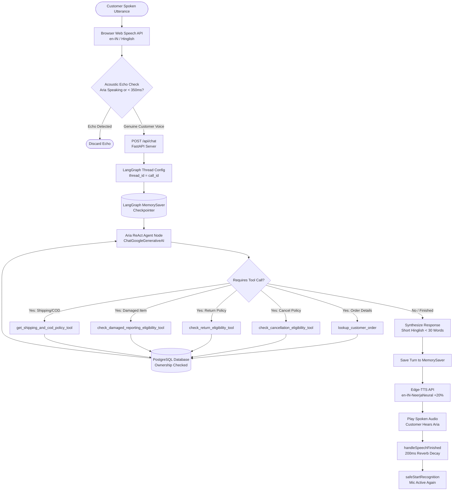

# Aura Skincare Voice Agent — AI Agent Workflow

## 1. Document Information

| Field | Value |
|---|---|
| Project | Aura Skincare Voice Agent |
| Document | AI Agent Workflow & Voice Orchestration |
| Version | 1.0 |
| Status | Implemented & Verified |
| Frameworks | LangGraph, LangChain Core, Google Generative AI (`gemini-3.5-flash-lite` / `gemini-2.5-flash`) |
| Speech Engine | Web Speech API (`en-IN` / `hi-IN` / `en-US`), Edge-TTS (`en-IN-NeerjaNeural`) |

---

## 2. Dual-Bot System Philosophy

The Aura Skincare application features two distinctly specialized AI assistants to provide optimal customer experience for different interaction modes:

```
┌────────────────────────────────────────────────────────────────────────┐
│                        AURA SKINCARE AI SYSTEM                         │
├───────────────────────────────────┬────────────────────────────────────┤
│   BOT 1: FAST TEXT CHATBOT        │   BOT 2: LIVE VOICE AGENT (ARIA)   │
├───────────────────────────────────┼────────────────────────────────────┤
│ • UI: Right-hand slide-out drawer │ • UI: Immersive Voice Call Studio  │
│ • Focus: Ingredients, routines,   │ • Focus: Real-time orders, returns,│
│   botanicals, skin types          │   cancellations, phone support     │
│ • Latency: Sub-second (~300ms)    │ • Latency: Voice-tuned (<1.2s)     │
│ • Tools: None (Direct LLM chat)   │ • Tools: 5 Deterministic ReAct     │
│ • State: Client-passed history    │ • State: LangGraph MemorySaver     │
│ • Audio: Text-only                │ • Audio: Full 2-way speech loop    │
└───────────────────────────────────┴────────────────────────────────────┘
```

---

## 3. Bot 2: Aria Voice Agent Architecture

Aria is built using **LangGraph** with a ReAct (Reason + Act) loop, configured with strict policy guardrails and per-call conversation memory.

### 3.1 LangGraph ReAct State Graph



---

## 4. Deterministic Tool Catalog

To prevent hallucinations, false promises, or incorrect calculations, the agent delegates all policy and database evaluations to deterministic Python functions registered as `@tool`s in `backend/app/ai_tools.py`:

### 4.1 `lookup_customer_order`
- **Purpose**: Retrieves full order facts from PostgreSQL.
- **Input Argument**: `order_id` (e.g. `"ORD-101"` or `"101"`).
- **Security Check**: Enforces that the order belongs to the authenticated customer (`customer_id`).
- **Return Fields**: `order_id`, `status`, `product_name`, `amount`, `courier`, `tracking_number`, `expected_delivery`, `delivered_days_ago`.

### 4.2 `check_cancellation_eligibility_tool`
- **Purpose**: Evaluates whether an order can be cancelled based on brand rules.
- **Rules Enforced**:
  - `Processing`: **Eligible**. Returns `eligible: True`.
  - `In Transit` / `Out for Delivery` / `Delivered`: **Ineligible**. Explains that dispatch has occurred and instructs customer to refuse delivery at their doorstep.
  - Non-existent order: Returns clear error asking customer to check the ID.

### 4.3 `check_return_eligibility_tool`
- **Purpose**: Determines return eligibility based on delivery date and product condition.
- **Rules Enforced**:
  - `delivered_days_ago > 7`: **Ineligible** (return window expired).
  - `delivered_days_ago <= 7`: **Eligible** provided products are unopened, unused, and in original packaging. If condition is unknown, instructs the agent to ask the customer first.
  - Status not delivered: Ineligible until package arrives.

### 4.4 `check_damaged_reporting_eligibility_tool`
- **Purpose**: Handles damaged or defective product reports.
- **Rules Enforced**:
  - Must be reported within **48 hours** of delivery.
  - Requires clear photos of the packaging and damage for a free replacement.
  - If photos are not yet provided, reminds the customer to submit them.

### 4.5 `get_shipping_and_cod_policy_tool`
- **Purpose**: Provides exact shipping fees and Cash on Delivery limitations.
- **Rules Enforced**:
  - Free shipping on orders over **₹499**; flat **₹50** fee for orders below ₹499.
  - Standard delivery timeline: **3–5 business days**.
  - Cash on Delivery (COD) available up to **₹2,500** payable via Cash or UPI.

---

## 5. System Prompt & Hinglish Persona

Aria is instructed via the system prompt (`backend/app/agent.py`) to maintain a friendly, natural Hinglish persona tuned for Indian D2C customer support:

```markdown
LANGUAGE STYLE — HINGLISH (MANDATORY):
- You MUST reply in Hinglish: a natural, casual mix of Hindi and English.
- Use romanized Hindi words naturally mixed with English:
  "Haan bilkul, aapka order ORD-101 abhi Out for Delivery hai, aaj shaam tak mil jayega!"
  "Arre nahi, ye order cancel nahi ho sakta kyunki ye already shipped ho chuka hai."
- Do NOT write in Devanagari script. Always use Roman/Latin letters.
- Keep the tone friendly, warm, conversational — like talking to a friend.
- Voice Style: SHORT & DIRECT (1 to 2 sentences max, under 30 words).
- Action Integrity: NEVER promise an order is cancelled or refunded unless verified by a tool.
- Human Support Requests: Never pretend to transfer a call; point to the "Call Customer Care" button on screen.
```

---

## 6. Real-Time Voice Orchestration Pipeline

The voice interaction loop is implemented entirely in the browser without telephony plugins, utilizing web standards:

### 6.1 Speech-to-Text (STT)
- **Engine**: Browser `window.SpeechRecognition` / `window.webkitSpeechRecognition`.
- **Language**: Defaulted to `en-IN` (English - India with Hinglish vocabulary support), with an interactive language selector in the UI (`🇮🇳 Hinglish / en-IN`, `🇮🇳 Hindi / hi-IN`, `🌐 English / en-US`).
- **Turn-Taking**:
  - Submits immediately on `isFinal` recognition.
  - Auto-submits on interim results if silence persists for **1.2 seconds**.
- **Heartbeat Auto-Recovery**: A 1.5s background interval checks if Chrome silently stopped recognition and revives it automatically.

### 6.2 Acoustic Echo Suppression
To prevent Aria from hearing her own voice played through device speakers:
1. Microphone recognition is aborted immediately when Aria starts speaking audio.
2. An acoustic decay window of **350ms** allows room reverberations to settle after audio ends before opening the microphone.
3. During active speech, any transcript matching Aria's recent text (>75% overlap or verbatim phrase >= 15 chars) is discarded.

### 6.3 Real-Time Microphone Decibel Visualizer
- Uses `AudioContext` and `AnalyserNode` connected to `navigator.mediaDevices.getUserMedia`.
- Computes real-time RMS volume (0–100%) and animates the 7 soundwave bars dynamically when the customer speaks.
- Displays a live **"Mic Vol: X%"** meter and a glowing green **"Microphone Live & Tracking"** status pill.

### 6.4 Real-Time Barge-In Interruption
- While Aria is speaking audio, if the customer speaks 2 or more characters:
  1. `currentAudioRef.current.pause()` stops playback instantly.
  2. `window.speechSynthesis.cancel()` halts any browser speech fallback.
  3. UI triggers an "⚡ Interrupted • Aria paused" visual alert.
  4. State shifts instantly to `listening` to process the customer's new request.

### 6.5 Text-to-Speech (TTS)
- **Primary**: Microsoft Edge TTS generating natural Indian English audio using voice `en-IN-NeerjaNeural` at `+20%` speed.
- **Fallback**: Browser `SpeechSynthesisUtterance` (`en-IN` voice) with a safety watchdog timer so audio playback never hangs indefinitely.

---

## 7. Post-Call Summarization & Automation

When a call ends (either by clicking "End Call" or closing the studio):
1. **Duration Tracking**: Active call duration is calculated from the start timestamp.
2. **Intent & Detail Extraction**: `classify_and_summarize_call` evaluates the conversation text to extract:
   - `customer_intent`: Classified category (e.g. `Order Cancellation Request`, `Damaged Product Report`).
   - `order_id`: Detected order ID (`ORD-xxx`).
   - `important_details`: Essential factual summary.
   - `resolution_status`: `Resolved`, `Escalated`, or `Follow-up Required`.
   - `requires_human_support`: Boolean flag.
3. **Database Persistence**: The interaction is saved to `saved_interactions` linked to the customer.
4. **n8n Automation Trigger**: If the call involved an important order or escalation, FastAPI dispatches an asynchronous background webhook to n8n (`POST /webhook/aura-call-summary`).
5. **Memory Cleanup**: LangGraph's in-memory thread checkpoint for that `call_id` is cleanly wiped from memory to preserve system resources.
